<div align="center">

# Kindred

**A full-stack dating app with real-time chat, built with FastAPI and React.**

Swipe through people who fit you, see *why* they fit, match, and chat live: typing indicators, read receipts and online presence over WebSockets.


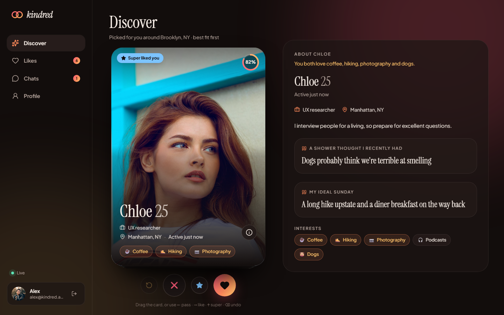

</div>

## Highlights

- **Swipe deck** with drag gestures, keyboard shortcuts (← → ↑ ⌫), like / pass / super like and undo.
- **Transparent matching.** Every card shows a 0–100 compatibility score and highlights shared interests. Discover only shows people whose gender *and* age preferences match yours, and yours theirs.
- **Live chat over WebSockets**: instant delivery, typing indicators, read receipts, online presence, optimistic sending with retry, an offline queue and auto-reconnect with exponential backoff.
- **"It's a match!"** celebration, pushed to both people in real time.
- **Icebreakers** generated from your shared interests and the other person's prompts.
- **Likes you** page: like someone back for an instant match.
- **Profile editor** with photo upload (validated, EXIF-rotated, resized and converted to WebP with Pillow), interests, prompts and preferences.
- **A demo that feels alive.** About 45 seeded personas like you back and reply in chat with context-aware messages, so a reviewer can try the full flow alone.
- Responsive from 360px phones up to wide desktops, with a dark design system built on Instrument Serif and Plus Jakarta Sans.

| Match | Live chat | Likes you |
| --- | --- | --- |
| 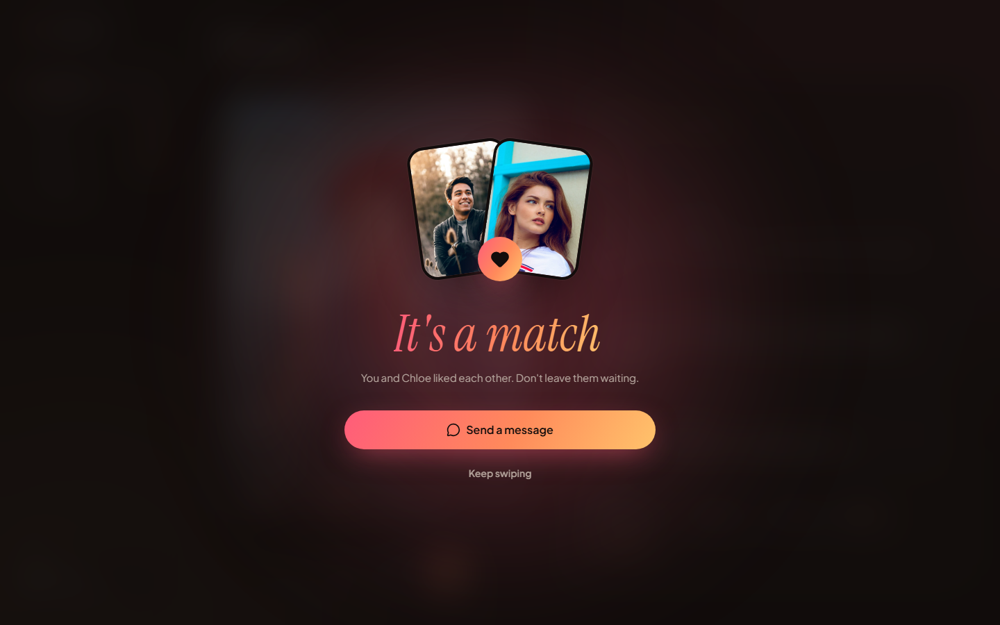 | 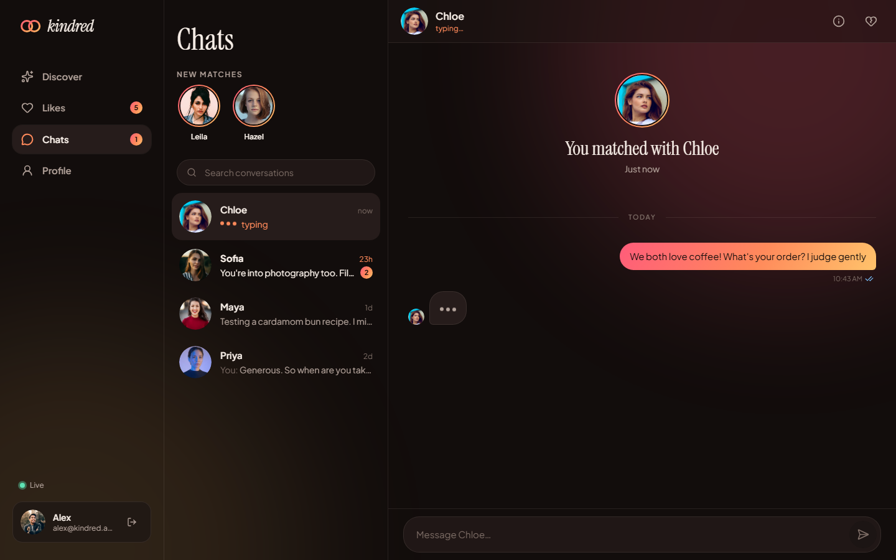 | 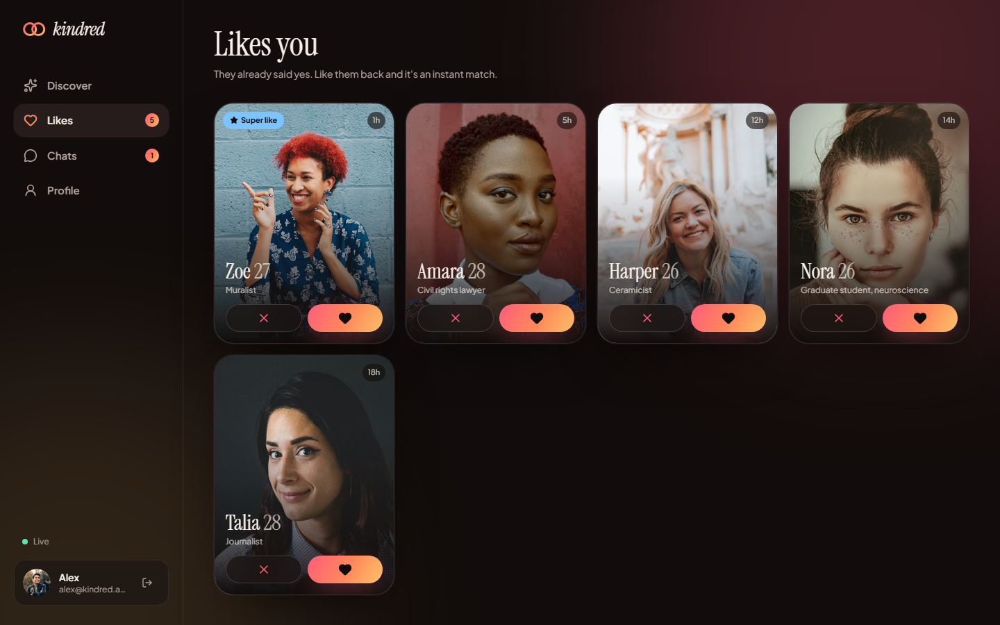 |

| Landing | Icebreakers | Profile |
| --- | --- | --- |
| 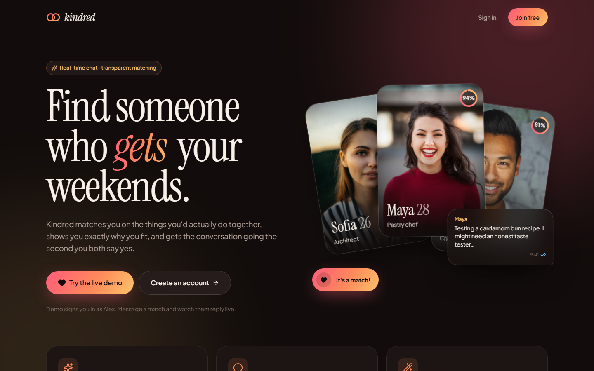 | 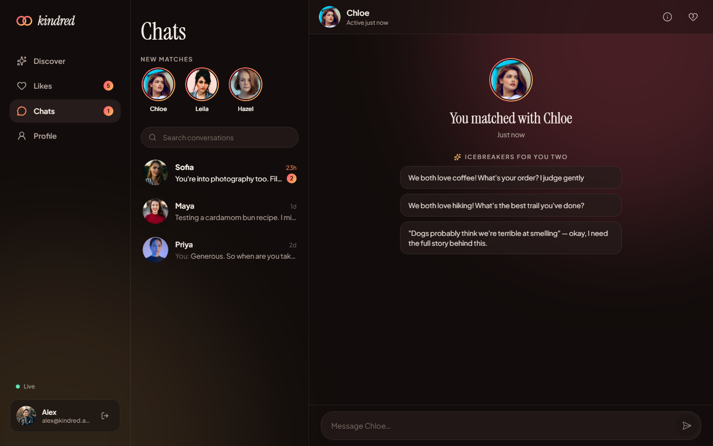 | 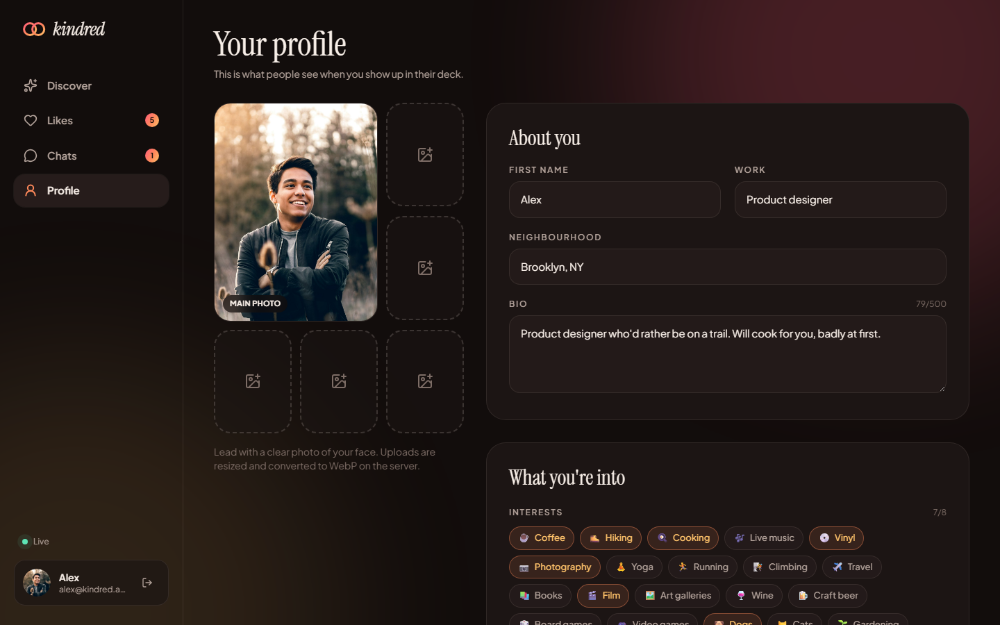 |

<p align="center">
  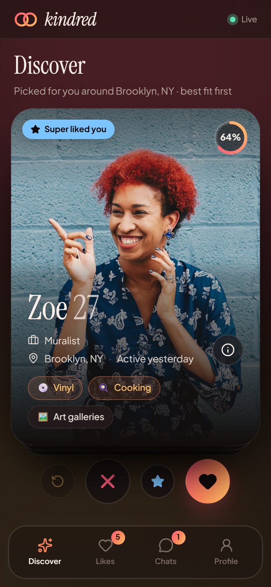
  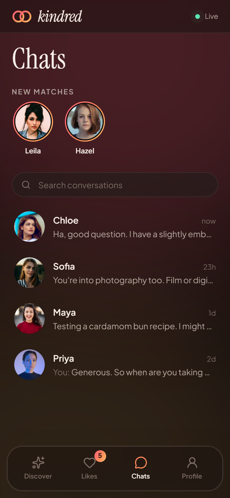
  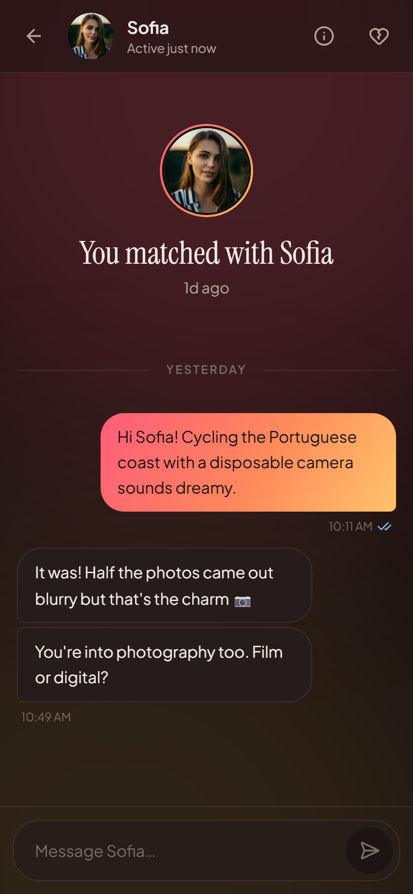
</p>

## Try it in two minutes

You need **Python 3.12+** and **Node 20+**.

```bash
# 1. API (http://localhost:8000, interactive docs at /docs)
cd backend
python -m venv .venv
source .venv/bin/activate        # Windows: .venv\Scripts\activate
pip install -e ".[dev]"
uvicorn app.main:app --reload
```

```bash
# 2. Web app (http://localhost:5173), in a second terminal
cd frontend
npm install
npm run dev
```

The database is created and seeded on first start. Open http://localhost:5173 and click **Try the live demo**.

| Account | Email | Password |
| --- | --- | --- |
| Demo user | `alex@kindred.app` | `kindred123` |
| Second real user | `maya@kindred.app` | `kindred123` |

**See two people chat live:** sign in as Alex in one window and as Maya in a private window. They're already matched, so open the conversation on both sides and watch messages, typing and read receipts update instantly. To start over, run `python -m app.seed --reset`.

### Or with Docker

```bash
docker compose up --build
# open http://localhost:8080
```

Nginx serves the built React app and proxies `/api`, `/media` and the `/ws` WebSocket to the API container. SQLite and uploaded photos live in a named volume.

## Architecture

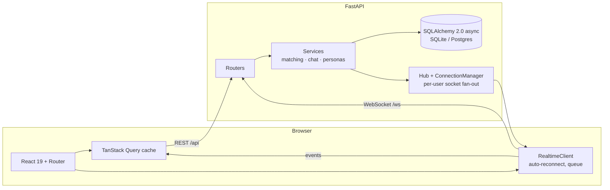

**Backend (`backend/app`)**

| Path | Responsibility |
| --- | --- |
| `main.py` | App factory, lifespan (create tables, seed, shut down background tasks), CORS, static media |
| `models.py` | `User`, `Swipe`, `Match`, `Message`. Constraints: one swipe per pair, ordered unique match pair, cascading deletes |
| `schemas.py` | Pydantic v2 models: validation (18+, known interests and prompts, age ranges) and response shapes |
| `routers/` | `auth`, `users` (profile, photos, meta), `discover` (deck, swipes, undo, likes), `matches` (list, history, read, unmatch, icebreakers), `ws` |
| `services/matching.py` | Age maths, mutual-preference filter and the compatibility score |
| `services/chat.py` | Sending, read receipts, match creation and persona auto-replies, shared by REST and WebSocket |
| `realtime.py` | `ConnectionManager` (multi-tab, per-user fan-out) and `Hub` (background task registry) |
| `db.py` | Async engine, `UTCDateTime` type so SQLite hands back time-zone-aware datetimes |

**Frontend (`frontend/src`)**

| Path | Responsibility |
| --- | --- |
| `lib/realtime.ts` | Framework-free WebSocket client: backoff with jitter, keep-alive pings, offline queue, 4401 sign-out |
| `realtime/RealtimeProvider.tsx` | Folds server events into the React Query cache, typing timeouts and toasts |
| `lib/cache.ts` | Pure, unit-tested cache reducers (`upsertMessage`, `applyReadReceipt`, …) |
| `pages/` | Landing, Login/Signup (3-step onboarding), Discover, Likes, Chats + Chat, Profile |
| `components/` | `SwipeCard` (motion drag physics), `MatchCelebration`, `ProfileDetails`, form controls, app shell |
| `store/` | Zustand: persisted auth, live presence/typing state, toasts |

### Real-time protocol

One socket per tab at `/ws?token=<JWT>` (browsers can't set headers on WebSocket requests, so the token goes in the query string).

| Direction | Event | Payload |
| --- | --- | --- |
| client → server | `message.send` | `match_id`, `body`, `client_id` (echoed back to reconcile the optimistic message) |
| | `typing` | `match_id`, `is_typing` |
| | `read` | `match_id` |
| | `ping` | keeps proxies from closing idle sockets |
| server → client | `hello` | which of your matches are online right now |
| | `message.new` | the stored message, sent to both participants |
| | `typing` · `read` · `presence` | live indicators |
| | `match.new` · `match.removed` | pushed when a like becomes mutual, or on unmatch |
| | `error` | validation problems; the socket stays open |

Bad tokens are rejected with close code `4401`, which makes the client sign out instead of retrying. `ConnectionManager` is in-process; to run several API workers, publish events through Redis pub/sub instead (the `send` interface stays the same).

### Compatibility score

A deliberately simple, explainable formula (`services/matching.py`):

| Signal | Weight | How |
| --- | --- | --- |
| Shared interests | 55 | overlap ÷ the smaller interest list, so a short list that fully matches still scores well |
| Age closeness | 25 | full marks within 2 years, fading to 0 at a 12-year gap |
| Recent activity | 20 | full marks if active today, fading over two weeks |

The SQL query narrows candidates on indexed columns (not swiped, not rejected by them, gender, birthdate range). The JSON "interested in" check and scoring run in Python, so the same code works on SQLite and Postgres.

## Tests

```bash
cd backend && pytest            # 36 tests: auth, profile, photos, discover rules, swipes, chat, WebSocket flows, personas, seed
cd frontend && npm test         # 27 tests: realtime client (fake socket and timers), cache reducers, time helpers, form components
```

The WebSocket tests drive two real connections through the app: presence, typing, delivery, the `client_id` echo, read receipts, live `match.new` pushes, and a persona reading, typing and replying. CI (`.github/workflows/ci.yml`) runs ruff, pytest, the TypeScript check, Vitest and a production build on every push.

## Configuration

All settings are environment variables with a `KINDRED_` prefix (see `backend/.env.example`):

| Variable | Default | Notes |
| --- | --- | --- |
| `KINDRED_SECRET_KEY` | dev value | **Set this in production** (JWT signing key) |
| `KINDRED_DATABASE_URL` | `sqlite+aiosqlite:///backend/kindred.db` | Any async SQLAlchemy URL, e.g. `postgresql+asyncpg://…` (after `pip install asyncpg`) |
| `KINDRED_DEMO_MODE` | `true` | Personas like back and reply |
| `KINDRED_SEED_ON_STARTUP` | `true` | Seed an empty database on boot |
| `KINDRED_CORS_ORIGINS` | `["http://localhost:5173"]` | JSON list |

## What I'd add next

- Alembic migrations and Postgres in Docker Compose
- Redis pub/sub so the WebSocket layer scales across workers
- Distance-based matching with PostGIS
- Block and report, and moderation of uploaded photos
- Push notifications for messages while the app is closed

## Credits

Profile photos are from [Unsplash](https://unsplash.com) and used under the Unsplash License. All names, bios and conversations are fictional.

## License

[MIT](LICENSE)
