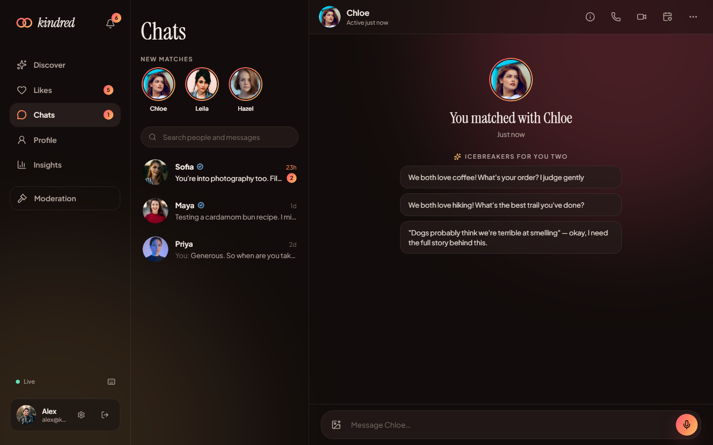
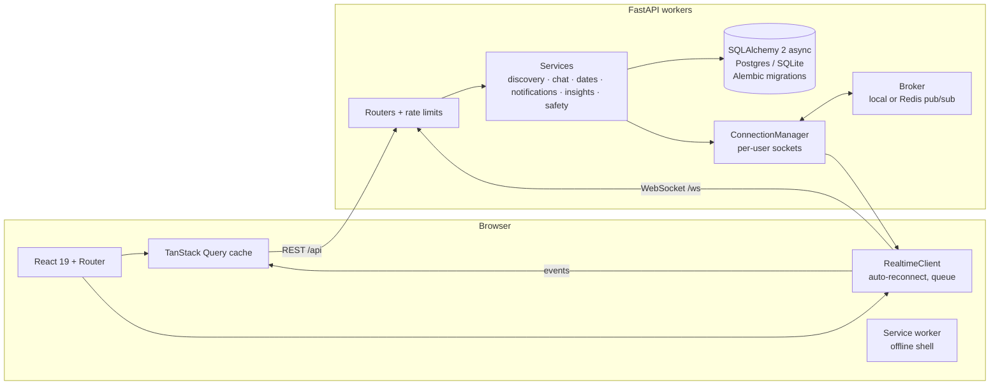

<div align="center">

# Kindred

**A full-stack dating app with real-time chat, built with FastAPI and React.**

Swipe through people who fit you, see *why* they fit, match, chat live and plan the first date: typing indicators, read receipts, reactions and presence over WebSockets.


</div>

## Highlights

**Meeting people**
- **Swipe deck** with drag gestures, keyboard shortcuts (← → ↑ ⌫), like / pass / super like and undo.
- **Transparent matching.** Every card shows a 0–100 compatibility score and the interests you share. Discover only shows people whose gender, age *and distance* preferences fit yours, and yours theirs.
- **Distance** from a built-in list of places or the browser's location. Others only ever see a rounded distance, never coordinates.
- **Daily top picks:** four standouts from your strongest fits, with a reason for each, refreshed at midnight.
- **Likes you** page and an **"It's a match!"** celebration, pushed to both people in real time.

**Talking**
- **Live chat over WebSockets**: instant delivery, typing indicators, read receipts, online presence, optimistic sending with retry, an offline queue and auto-reconnect with backoff.
- **Reactions** (double-click to ❤️), **unsend** within 15 minutes, **photo messages** with a lightbox, and **icebreakers** from shared interests.
- **Date planning** inside the chat: propose a place and time from suggested ideas, accept or decline live, and add it to your calendar (`.ics`).
- **Notifications** for likes, matches and missed messages, a bell with a live feed, unread counts in the tab title and opt-in desktop notifications.

**Your profile**
- **Profile editor** with photo upload (validated, EXIF-rotated, resized and converted to WebP with Pillow), interests, prompts and preferences, plus a **profile strength** meter with tips.
- **Insights:** likes, match rate, reply rate and reply speed, day-by-day charts and what the people who like you are into.
- **Settings:** pause your profile, change your password (which signs out your other devices), sign out everywhere, desktop notifications, blocked people and account deletion.

**Safety and operations**
- **Block and report** from any chat. A block works in both directions and ends the match live.
- **Moderation queue** for admins: review reports, dismiss them, or ban (which revokes tokens and closes sockets immediately).
- **Rate limits** on sign-in, sign-up, swipes, messages, uploads and reports.
- **Installable PWA** with an offline app shell.
- **A demo that feels alive.** About 45 seeded personas like you back, reply in context and say yes to dates, so a reviewer can try every flow alone.

| Match | Live chat | Likes you |
| --- | --- | --- |
|  |  |  |

| Top picks | Planning a date | It's a date |
| --- | --- | --- |
|  |  |  |

| Insights | Notifications | Moderation |
| --- | --- | --- |
|  |  |  |

| Landing | Icebreakers | Profile |
| --- | --- | --- |
|  |  |  |

<p align="center">
  
  
  
</p>

## Try it in two minutes

You need **Python 3.12+** and **Node 20+**.

```bash
# 1. API (http://localhost:8000, interactive docs at /docs)
cd backend
python -m venv .venv
source .venv/bin/activate        # Windows: .venv\Scripts\activate
pip install -e ".[dev]"
uvicorn app.main:app --reload
```

```bash
# 2. Web app (http://localhost:5173), in a second terminal
cd frontend
npm install
npm run dev
```

The database is migrated and seeded on first start. Open http://localhost:5173 and click **Try the live demo**.

| Account | Email | Password |
| --- | --- | --- |
| Demo user (also a moderator) | `alex@kindred.app` | `kindred123` |
| Second real user | `maya@kindred.app` | `kindred123` |

**See two people chat live:** sign in as Alex in one window and as Maya in a private window. They're already matched, so open the conversation on both sides and watch messages, typing, reactions and read receipts update instantly. To start over, run `python -m app.seed --reset`.

### Or with Docker

```bash
docker compose up --build
# open http://localhost:8080
```

Compose runs the API on **Postgres 17** with **Redis** as the real-time broker, behind nginx, which serves the built React app and proxies `/api`, `/media` and the `/ws` WebSocket. Uploaded photos live in a named volume.

## Architecture



**Backend (`backend/app`)**

| Path | Responsibility |
| --- | --- |
| `main.py` | App factory, lifespan (migrate, seed, start the broker, shut down background tasks), CORS, static media |
| `models.py` | Users, swipes, matches, messages, reactions, blocks, reports, notifications and date proposals, with the constraints that keep them honest |
| `migrations/` | Alembic revisions, applied on startup. A test fails if the models drift from them |
| `schemas.py` | Pydantic v2 models: validation (18+, known interests and prompts, ranges, aware datetimes) and response shapes |
| `routers/` | `auth`, `users`, `account`, `discover`, `matches`, `dates`, `notifications`, `safety`, `admin`, `ws` |
| `services/discovery.py` | Who can see whom (mutual gender, age and distance fit, blocks, pauses, bans) and the daily top picks |
| `services/matching.py` | Age maths, the compatibility score, haversine distance and the SQL bounding box |
| `services/chat.py` | Sending, reactions, unsend, read receipts and persona auto-replies, shared by REST and WebSocket |
| `services/dates.py` · `notifications.py` · `insights.py` · `profile_strength.py` · `safety.py` · `images.py` | One feature each |
| `realtime.py` · `broker.py` | `ConnectionManager` (multi-tab, per-user fan-out) behind a broker: in-process by default, Redis pub/sub across workers |
| `limits.py` · `ratelimit.py` | Sliding-window limiter and the FastAPI dependencies that apply it |

**Frontend (`frontend/src`)**

| Path | Responsibility |
| --- | --- |
| `lib/realtime.ts` | Framework-free WebSocket client: backoff with jitter, keep-alive pings, offline queue, 4401 sign-out |
| `realtime/RealtimeProvider.tsx` | Folds server events into the React Query cache; typing timeouts, toasts and desktop notifications |
| `lib/cache.ts` · `notifications.ts` · `dates.ts` | Pure, unit-tested reducers (`upsertMessage`, `applyReaction`, `applyNotification`, `upsertDate`, …) |
| `pages/` | Landing, Login/Signup, Discover, Likes, Chats + Chat, Profile, Insights, Settings, Moderation |
| `components/` | `SwipeCard`, `TopPicks`, `DatePlanner`, `Reactions`, `MessageActions`, `Safety`, `Notifications`, `ProfileStrength`, … |
| `store/` | Zustand: persisted auth and preferences, live presence/typing state, toasts |

### Real-time protocol

One socket per tab at `/ws?token=<JWT>` (browsers can't set headers on WebSocket requests, so the token goes in the query string).

| Direction | Event | Payload |
| --- | --- | --- |
| client → server | `message.send` | `match_id`, `body`, `client_id` (echoed back to reconcile the optimistic message) |
| | `typing` · `read` | `match_id` (+ `is_typing`) |
| | `react` | `match_id`, `message_id`, `emoji` (or `null` to remove) |
| | `ping` | keeps proxies from closing idle sockets |
| server → client | `hello` | which of your matches are online right now |
| | `message.new` · `message.deleted` | the stored message, or which one was unsent |
| | `typing` · `read` · `reaction` · `presence` | live indicators |
| | `match.new` · `match.removed` | pushed when a like becomes mutual, or on unmatch and block |
| | `date.updated` | a date proposal was made, answered or called off |
| | `notification.new` | a like, match or missed message for the bell |
| | `error` | validation problems or rate limits; the socket stays open |

Bad, revoked or banned tokens are closed with code `4401`, which makes the client sign out instead of retrying. With `KINDRED_REDIS_URL` set, every event goes through Redis pub/sub, so a message sent through one API worker reaches sockets held by another. Presence is still tracked per process.

### Compatibility score

A deliberately simple, explainable formula (`services/matching.py`):

| Signal | Weight | How |
| --- | --- | --- |
| Shared interests | 55 | overlap ÷ the smaller interest list, so a short list that fully matches still scores well |
| Age closeness | 25 | full marks within 2 years, fading to 0 at a 12-year gap |
| Recent activity | 20 | full marks if active today, fading over two weeks |

The SQL query narrows candidates on indexed columns (not swiped, not rejected by them, not blocked, gender, birthdate range, a latitude/longitude bounding box). The JSON "interested in" check, exact distance and scoring run in Python, so the same code works on SQLite and Postgres.

## Tests and CI

```bash
cd backend && pytest            # 105 tests: auth, account, discover, distance, chat, reactions, photos, dates,
                                #   notifications, insights, safety, moderation, rate limits, broker, migrations, seed
cd frontend && npm run lint && npm test   # 82 tests: realtime client, cache reducers, components and pages
```

The WebSocket tests drive real connections through the app: presence, typing, delivery, the `client_id` echo, read receipts, reactions, live `match.new` pushes, personas replying and accepting dates, and bans closing sockets. The broker tests run two workers against one fake Redis. A migration test upgrades a database that holds a conversation and checks every row survives.

CI (`.github/workflows/ci.yml`) runs ruff and pytest on SQLite, the whole backend suite again on a **Postgres 17** service, and ESLint, the TypeScript check, Vitest and a production build for the web app.

## Configuration

All settings are environment variables with a `KINDRED_` prefix (see `backend/.env.example`):

| Variable | Default | Notes |
| --- | --- | --- |
| `KINDRED_SECRET_KEY` | dev value | **Set this in production** (JWT signing key) |
| `KINDRED_DATABASE_URL` | `sqlite+aiosqlite:///backend/kindred.db` | Any async SQLAlchemy URL, e.g. `postgresql+asyncpg://…` (`pip install ".[postgres]"`) |
| `KINDRED_REDIS_URL` | unset | Fan events out through Redis to run several workers (`pip install ".[redis]"`) |
| `KINDRED_RATE_LIMIT_ENABLED` | `true` | Per-process sliding-window limits |
| `KINDRED_DEMO_MODE` | `true` | Personas like back, reply and accept dates |
| `KINDRED_SEED_ON_STARTUP` | `true` | Seed an empty database on boot |
| `KINDRED_CORS_ORIGINS` | `["http://localhost:5173"]` | JSON list |

Schema changes go through Alembic: edit `models.py`, then run `alembic revision --autogenerate -m "what changed"` in `backend/` and review the generated file.

## What I'd add next

- Presence and rate-limit counters in Redis, so they're shared across workers too
- Web Push, so notifications arrive while the app is closed
- End-to-end tests with Playwright in CI
- Automated screening of uploaded photos before they reach the moderation queue
- Translations

## Credits

Profile photos are from [Unsplash](https://unsplash.com) and used under the Unsplash License. All names, bios and conversations are fictional.

## License

[MIT](LICENSE)
